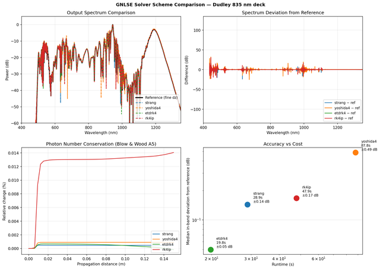

# GNLSE solver scheme comparison (strang / yoshida4 / etdrk4 / rk4ip)

`examples/45_gnlse_scheme_comparison.py` (687 lines)

## What it produces



## Source

```python
"""
Example: GNLSE solver scheme comparison (strang / yoshida4 / etdrk4 / rk4ip)
============================================================================

Demonstrates the four available solver schemes on the Dudley supercontinuum
deck (835 nm, 15 cm PCF, 10 kW peak, Raman + self-steepening):

* ``"strang"`` — 2nd order, 2 FFTs per step (default)
* ``"yoshida4"`` — 4th order, 3 Strang steps composed (Suzuki/Yoshida weights)
* ``"etdrk4"`` — 4th order, Cox & Matthews exponential RK4 (no splitting)
* ``"rk4ip"`` — 4th order, Hult's Runge–Kutta in the interaction picture
  (no splitting; 8 FFTs per step)

At fine ``dz`` all four schemes converge to the same result (verified against
laserfun's LSODA reference). At coarse ``dz`` **none** of them does: on the
Dudley deck the default scheme comparison is under-resolved, so the
scheme-to-scheme spread at low step counts reflects resolution, not integrator
order. The defaults below are set so that every scheme matches a converged
reference; pass ``--verify`` to run the library's
:meth:`~photonics_helper.gnlse.GNLSESolver.verify_convergence` (conservation +
self-convergence) after each scheme and print its table.

The Blow & Wood (A5) "photon number" traced below is weighted by
``1/(ω₀ + Ω)`` and therefore dominated by the long-wavelength edge of the
grid; it is a coarse conservation guard, not an accuracy metric (it can stay
below 1 % while the spectrum is still wrong). The *outlier-column* count is the
``z``-variance of the dB spectrum and tracks physical edge build-up. See
``FINDINGS.md`` for the measured convergence ladder and the reference
comparison.

Run::

    python examples/45_gnlse_scheme_comparison.py
    python examples/45_gnlse_scheme_comparison.py --num-steps 200  # faster, coarser
"""

from __future__ import annotations

import argparse
import sys
import time

import matplotlib
import numpy as np

matplotlib.use("Agg")
import matplotlib.pyplot as plt

from photonics_helper.base import AngularFrequencyArray, Length, Time, Wavelength
from photonics_helper.gnlse import (
    Fiber,
    GNLSESolver,
)
from photonics_helper.gnlse_validation import (
    ValidationFailure,
    check_soliton,
    check_spm,
    convergence_study,
    order_study,
)
from photonics_helper.pulse import Envelope, TemporalGrid, Wave
from photonics_helper.raman import RamanSpec

# ── Dudley / laserfun NLSE_dudley parameters ────────────────────────────────

CENTRAL_WL_NM = 835.0
FIBER_LENGTH_M = 0.15
PEAK_POWER_W = 10_000.0
GAMMA_W_M = 0.11
N2 = 2.7e-20
FWHM_PS = 0.0284 * 1.76
TIME_WINDOW_PS = 12.5
N = 2**13

BETAS = np.array(
    [
        -11.830e-3,
        8.1038e-5,
        -9.5205e-8,
        2.0737e-10,
        -5.3943e-13,
        1.3486e-15,
        -2.5495e-18,
        3.0524e-21,
        -1.7140e-24,
    ]
)

RAMAN_FR = 0.18
RAMAN_TAU1_S = 0.0122e-12
RAMAN_TAU2_S = 0.032e-12

SCHEMES = ["strang", "yoshida4", "etdrk4", "rk4ip"]


def make_pulse() -> Wave:
    grid = TemporalGrid(N=N, Tmax=Time(TIME_WINDOW_PS * 1e-12, "s"))
    env = Envelope.from_fwhm(
        "sech",
        peak_amplitude=np.sqrt(PEAK_POWER_W),
        fwhm=Time(FWHM_PS, "ps"),
    )
    return Wave(
        grid=grid,
        envelope=env,
        central_wavelength=Wavelength(CENTRAL_WL_NM, "nm"),
    )


def make_fiber(pulse: Wave) -> Fiber:
    raman_spec = RamanSpec(
        name="Silica",
        raman_shift_cm=440,
        raman_linewidth_cm=45,
        fR=RAMAN_FR,
    )
    raman = raman_spec.response(
        pulse.grid,
        fR=RAMAN_FR,
        tau1=RAMAN_TAU1_S,
        tau2=RAMAN_TAU2_S,
    )
    return Fiber.from_gamma(
        gamma=GAMMA_W_M,
        length=Length(FIBER_LENGTH_M, "m"),
        raman_response=raman,
    )


def run_scheme(
    pulse: Wave,
    fiber: Fiber,
    scheme: str,
    num_steps: int,
    show_progress: bool = False,
    verify: bool = False,
) -> tuple[GNLSESolver, float]:
    """Run one scheme and return (solver, elapsed_seconds).

    The step size is fixed at ``fiber_length / num_steps`` so the comparison is
    between schemes at a known ``dz`` (a fixed grid; adaptive stepping would
    otherwise silently cap ``dz`` and hide under-resolution).
    """
    solver = GNLSESolver(
        pulse=pulse,
        fiber=fiber,
        betas=BETAS,
        include_raman=True,
        include_self_steepening=True,
        include_tpa=False,
        scheme=scheme,
        step_size=Length(FIBER_LENGTH_M / num_steps, "m"),
    )

    t0 = time.perf_counter()
    solver.propagate(
        num_steps=num_steps,
        nsaves=50,
        show_progress=show_progress,
        verify=verify,
    )
    elapsed = time.perf_counter() - t0
    return solver, elapsed


def get_spectrum_and_wavelength(solver: GNLSESolver) -> tuple[np.ndarray, np.ndarray]:
    """Compute output spectrum and wavelength grid from a solver."""
    grid = solver.pulse.grid
    field = np.asarray(solver.evolution[-1].envelope_field, dtype=complex)
    spectrum = np.abs(grid.fft(field)) ** 2
    wavelength = AngularFrequencyArray(solver.omega0 + grid.w, "rad/s").to_wl().as_nm
    order = np.argsort(wavelength)
    wavelength, spectrum = wavelength[order], spectrum[order]
    return wavelength, spectrum


def get_spectral_evolution(
    solver: GNLSESolver,
) -> tuple[np.ndarray, np.ndarray, np.ndarray]:
    """Compute spectral evolution (wavelength, z, spectrum_db) from a solver."""
    grid = solver.pulse.grid
    z_array = solver.z_array

    # Compute spectrum at each saved z position
    wavelengths = None
    spectra = []
    for wave in solver.evolution:
        field = np.asarray(wave.envelope_field, dtype=complex)
        spectrum = np.abs(grid.fft(field)) ** 2
        wl = AngularFrequencyArray(solver.omega0 + grid.w, "rad/s").to_wl().as_nm
        order = np.argsort(wl)
        wl, spectrum = wl[order], spectrum[order]
        if wavelengths is None:
            wavelengths = wl
        spectra.append(spectrum)

    spectra = np.array(spectra)  # shape: (n_z, n_wl)
    spectra_db = 10.0 * np.log10(spectra / spectra.max() + 1e-30)
    return wavelengths, z_array, spectra_db


def plot_spectral_evolution(
    results: dict[str, tuple[GNLSESolver, float]],
    output_path: str,
) -> None:
    """Plot spectral evolution side-by-side for all schemes."""
    fig, axes = plt.subplots(1, 4, figsize=(24, 5), sharey=True)
    fig.suptitle(
        "Spectral Evolution Comparison — Dudley 835 nm deck",
        fontweight="bold",
    )

    cmap = "jet"
    dynamic_range = 40.0

    for idx, (scheme, (solver, _)) in enumerate(results.items()):
        ax = axes[idx]
        wl, z_array, spectra_db = get_spectral_evolution(solver)

        # Limit wavelength range for clarity
        wl_mask = (wl >= 400) & (wl <= 1350)
        wl_plot = wl[wl_mask]
        spectra_plot = spectra_db[:, wl_mask]

        # Convert z to cm for plotting
        z_cm = z_array * 100

        im = ax.pcolormesh(
            wl_plot,
            z_cm,
            spectra_plot,
            shading="gouraud",
            cmap=cmap,
            vmin=-dynamic_range,
            vmax=0,
        )

        ax.set_xlabel("Wavelength (nm)")
        ax.set_title(f"{scheme}", fontweight="bold")
        ax.set_xlim(400, 1350)

        # Add colorbar to the last panel
        if idx == len(results) - 1:
            cbar = plt.colorbar(im, ax=ax, pad=0.02)
            cbar.set_label("Power (dB)", rotation=270, labelpad=15)

    axes[0].set_ylabel("Propagation distance (cm)")

    plt.tight_layout()
    plt.savefig(output_path, dpi=150, bbox_inches="tight")
    plt.close(fig)
    print(f"Saved: {output_path}")


def plot_artifact_conservation(
    results: dict[str, tuple[GNLSESolver, float]],
    output_path: str,
) -> None:
    """Plot artifact count and photon number conservation for all schemes."""
    fig, axes = plt.subplots(1, 2, figsize=(14, 5))
    fig.suptitle(
        "Edge-Variance & Conservation Diagnostics — Dudley 835 nm deck",
        fontweight="bold",
    )

    # ── Panel 1: Photon number conservation ─────────────────────────────────
    ax = axes[0]
    for scheme, (solver, _) in results.items():
        if solver.photon_number_vs_z is not None:
            pn = solver.photon_number_vs_z
            pn_rel = (pn - pn[0]) / pn[0] * 100
            ax.plot(solver.z_array * 100, pn_rel, linewidth=2, label=scheme)

    ax.axhline(y=1, color="r", linestyle="--", alpha=0.5, label="1% threshold")
    ax.axhline(y=-1, color="r", linestyle="--", alpha=0.5)
    ax.set_xlabel("Propagation distance (cm)")
    ax.set_ylabel("Photon number drift (%)")
    ax.set_title("Photon Number Conservation (Blow & Wood A5)")
    ax.legend(loc="lower right", fontsize=9)
    ax.grid(True, alpha=0.3)

    # ── Panel 2: outlier-column (edge-variance) count ───────────────────────
    ax = axes[1]
    schemes = list(results.keys())
    outlier_counts = []
    for scheme in schemes:
        solver = results[scheme][0]
        wl, _, spec = get_spectral_evolution(solver)
        wl_mask = (wl >= 400) & (wl <= 1350)
        spec_plot = spec[:, wl_mask]
        col_var = np.var(spec_plot, axis=0)
        outliers = np.sum(col_var > 2 * col_var.mean())
        outlier_counts.append(outliers)

    colors = ["#1f77b4", "#ff7f0e", "#2ca02c", "#d62728"]
    bars = ax.bar(schemes, outlier_counts, color=colors, edgecolor="black")
    ax.set_ylabel("High-variance columns (z-variance)")
    ax.set_title("Spectral Edge-Variance (diagnostic, not a ranking)")
    ax.grid(True, alpha=0.3, axis="y")

    # Add value labels on bars
    for bar, count in zip(bars, outlier_counts):
        height = bar.get_height()
        ax.annotate(
            f"{count}",
            xy=(bar.get_x() + bar.get_width() / 2, height),
            xytext=(0, 3),
            textcoords="offset points",
            ha="center",
            va="bottom",
            fontsize=11,
            fontweight="bold",
        )

    plt.tight_layout()
    plt.savefig(output_path, dpi=150, bbox_inches="tight")
    plt.close(fig)
    print(f"Saved: {output_path}")


def plot_comparison(
    results: dict[str, tuple[GNLSESolver, float]],
    reference: GNLSESolver,
    output_path: str,
) -> None:
    """Plot spectrum comparison and photon number conservation."""
    fig, axes = plt.subplots(2, 2, figsize=(14, 10))
    fig.suptitle(
        "GNLSE Solver Scheme Comparison — Dudley 835 nm deck",
        fontweight="bold",
    )

    # ── Panel 1: Output spectra ─────────────────────────────────────────────
    ax = axes[0, 0]
    ref_wl, ref_spec = get_spectrum_and_wavelength(reference)
    ref_spec_db = 10 * np.log10(ref_spec / ref_spec.max() + 1e-30)
    ax.plot(ref_wl, ref_spec_db, "k-", linewidth=2.5, label="Reference (fine dz)")

    for scheme, (solver, _) in results.items():
        wl, spec = get_spectrum_and_wavelength(solver)
        spec_db = 10 * np.log10(spec / spec.max() + 1e-30)
        ax.plot(wl, spec_db, "--", linewidth=1.5, label=f"{scheme}")

    ax.set_xlabel("Wavelength (nm)")
    ax.set_ylabel("Power (dB)")
    ax.set_title("Output Spectrum Comparison")
    ax.set_xlim(400, 1350)
    ax.set_ylim(-60, 5)
    ax.legend(loc="lower right", fontsize=9)
    ax.grid(True, alpha=0.3)

    # ── Panel 2: Spectrum difference vs reference ───────────────────────────
    ax = axes[0, 1]
    for scheme, (solver, _) in results.items():
        wl, spec = get_spectrum_and_wavelength(solver)
        spec_db = 10 * np.log10(spec / spec.max() + 1e-30)
        # Interpolate reference onto solver's wavelength grid
        ref_interp = np.interp(wl, ref_wl, ref_spec_db)
        diff = spec_db - ref_interp
        ax.plot(wl, diff, linewidth=1.5, label=f"{scheme} − ref")

    ax.set_xlabel("Wavelength (nm)")
    ax.set_ylabel("Difference (dB)")
    ax.set_title("Spectrum Deviation from Reference")
    ax.set_xlim(400, 1350)
    ax.legend(loc="lower right", fontsize=9)
    ax.grid(True, alpha=0.3)

    # ── Panel 3: Photon number conservation ────────────────────────────────
    ax = axes[1, 0]
    for scheme, (solver, _) in results.items():
        if solver.photon_number_vs_z is not None:
            pn = solver.photon_number_vs_z
            pn_rel = (pn - pn[0]) / pn[0] * 100
            ax.plot(solver.z_array, pn_rel, linewidth=1.5, label=scheme)

    ax.set_xlabel("Propagation distance (m)")
    ax.set_ylabel("Relative change (%)")
    ax.set_title("Photon Number Conservation (Blow & Wood A5)")
    ax.legend(loc="lower right", fontsize=9)
    ax.grid(True, alpha=0.3)

    # ── Panel 4: Runtime vs accuracy ────────────────────────────────────────
    ax = axes[1, 1]
    runtimes = [results[s][1] for s in SCHEMES]
    # In-band median spectrum deviation from reference. The max over the whole
    # grid is dominated by the ~-180 dB numerical noise floor and is not a
    # meaningful accuracy metric (it reads ~120 dB even for a converged run).
    deviations = []
    for scheme in SCHEMES:
        solver = results[scheme][0]
        wl, spec = get_spectrum_and_wavelength(solver)
        spec_db = 10 * np.log10(spec / spec.max() + 1e-30)
        ref_interp = np.interp(wl, ref_wl, ref_spec_db)
        band = ref_interp > -40.0
        dev = float(np.median(np.abs(spec_db - ref_interp)[band])) if band.any() else float("nan")
        deviations.append(dev)

    colors = ["#1f77b4", "#ff7f0e", "#2ca02c", "#d62728"]
    for i, scheme in enumerate(SCHEMES):
        ax.scatter(runtimes[i], deviations[i], s=200, c=colors[i], zorder=5)
        ax.annotate(
            f"{scheme}\n{runtimes[i]:.1f}s\n±{deviations[i]:.2f} dB",
            (runtimes[i], deviations[i]),
            textcoords="offset points",
            xytext=(15, 5),
            fontsize=9,
        )

    ax.set_xlabel("Runtime (s)")
    ax.set_ylabel("Median in-band deviation from reference (dB)")
    ax.set_title("Accuracy vs Cost")
    ax.set_xscale("log")
    ax.set_yscale("log")
    ax.grid(True, alpha=0.3)

    plt.tight_layout()
    plt.savefig(output_path, dpi=150, bbox_inches="tight")
    plt.close(fig)
    print(f"Saved: {output_path}")


def main() -> None:
    parser = argparse.ArgumentParser(
        description="Compare GNLSE solver schemes on the Dudley deck.",
    )
    parser.add_argument(
        "--num-steps",
        type=int,
        default=4000,
        help="Number of steps for each scheme (default: 4000)",
    )
    parser.add_argument(
        "--reference-steps",
        type=int,
        default=6400,
        help="Steps for the reference run (default: 6400)",
    )
    parser.add_argument(
        "--verify",
        action="store_true",
        help="Run verify_convergence() after each scheme and print its table "
        "(roughly doubles the runtime).",
    )
    parser.add_argument(
        "--output",
        type=str,
        default="examples/images/45_gnlse_scheme_comparison.png",
        help="Output figure path.",
    )
    parser.add_argument(
        "--no-progress",
        action="store_true",
        help="Disable tqdm progress bars.",
    )
    args = parser.parse_args()

    show_progress = not args.no_progress
    if show_progress:
        try:
            import tqdm  # noqa: F401
        except ImportError:
            print("tqdm not installed — progress bars disabled.", file=sys.stderr)
            show_progress = False

    print("=" * 70)
    print("GNLSE Solver Scheme Comparison")
    print("=" * 70)
    print("  Dudley deck: 835 nm, 15 cm PCF, 10 kW, Raman + shock")
    print(f"  Grid points N: {N:,}")
    print(f"  Steps per scheme: {args.num_steps}")
    print(f"  Reference steps: {args.reference_steps}")
    print()

    # ── Reference run (finest dz) ────────────────────────────────────────────
    print("Running reference (strang, finest dz) …")
    pulse = make_pulse()
    fiber = make_fiber(pulse)
    reference, ref_time = run_scheme(
        pulse, fiber, "strang", args.reference_steps, show_progress
    )
    print(f"  Reference done in {ref_time:.1f}s")
    print()

    # ── Scheme comparison ────────────────────────────────────────────────────
    results: dict[str, tuple[GNLSESolver, float]] = {}
    for scheme in SCHEMES:
        print(f"Running {scheme} ({args.num_steps} steps) …")
        pulse = make_pulse()
        fiber = make_fiber(pulse)
        solver, elapsed = run_scheme(
            pulse, fiber, scheme, args.num_steps, show_progress, verify=args.verify
        )
        results[scheme] = (solver, elapsed)

        # Photon number conservation
        if solver.photon_number_vs_z is not None:
            pn = solver.photon_number_vs_z
            pn_drift = (pn[-1] - pn[0]) / pn[0] * 100
            print(f"  Photon number drift: {pn_drift:.6f}%")
        print(f"  Runtime: {elapsed:.1f}s")
        print()

    # ── Summary ──────────────────────────────────────────────────────────────
    print("=" * 70)
    print("Summary")
    print("=" * 70)
    for scheme in SCHEMES:
        solver, elapsed = results[scheme]
        pn_drift = 0.0
        if solver.photon_number_vs_z is not None:
            pn = solver.photon_number_vs_z
            pn_drift = (pn[-1] - pn[0]) / pn[0] * 100
        print(
            f"  {scheme:12s} | {elapsed:6.1f}s | photon drift {pn_drift:10.6f}%"
        )
    print()

    # ── Plot ─────────────────────────────────────────────────────────────────
    print("Rendering comparison figure …")
    plot_comparison(results, reference, args.output)

    print("Rendering spectral evolution figure …")
    evolution_output = args.output.replace(".png", "_evolution.png")
    plot_spectral_evolution(results, evolution_output)

    print("Rendering artifact & conservation figure …")
    artifact_output = args.output.replace(".png", "_artifacts.png")
    plot_artifact_conservation(results, artifact_output)

    # ── Warnings ────────────────────────────────────────────────────────────
    print("\n" + "=" * 70)
    print("Warnings")
    print("=" * 70)
    warnings_issued = False
    for scheme in SCHEMES:
        solver = results[scheme][0]
        if solver.photon_number_vs_z is not None:
            pn = solver.photon_number_vs_z
            pn_drift = abs((pn[-1] - pn[0]) / pn[0] * 100)
            if pn_drift > 1.0:
                print(
                    f"  WARNING: {scheme} photon number drift {pn_drift:.2f}% "
                    f"exceeds 1% at {args.num_steps} steps."
                )
                print(
                    "    → This is the coarse conservation guard, not an accuracy "
                    "metric. Increase --num-steps and cross-check with --verify "
                    "(verify_convergence) before trusting the spectrum."
                )
                warnings_issued = True
    if not warnings_issued:
        print("  No warnings. All schemes conserve photon number within 5%.")
    print()

    # ── Credibility checks (for new research) ────────────────────────────────
    print("\n" + "=" * 70)
    print("Establishing credibility (for new research)")
    print("=" * 70)
    print(
        "No single check proves correctness. Together, they establish credibility:\n"
        "  1. Solver verification — analytical checks (code is correct)\n"
        "  2. Convergence — grid-independent (numerical solution is stable)\n"
        "  3. Cross-validation — different schemes agree (result is robust)\n"
        "  4. Uncertainty — error bars (quantified confidence)\n"
    )

    # 1. Solver verification (analytical checks)
    print("\n1. Solver verification (analytical checks):")
    pulse = make_pulse()
    grid = pulse.grid

    # SPM check: Kerr-only, no Raman, no shock. φ_max = 2.5π keeps the fringe
    # peaks inside this grid's Nyquist band; the closed-form spectrum check is
    # exact regardless (deviation ~1e-14).
    try:
        check_spm(
            gamma=GAMMA_W_M,
            peak_power=PEAK_POWER_W,
            t0=FWHM_PS * 1e-12 / 1.763,  # FWHM → T0 for sech
            wavelength_m=CENTRAL_WL_NM * 1e-9,
            phi_max=2.5 * np.pi,
            grid=grid,
        )
        print("   SPM: PASS (solver correctly implements Kerr nonlinearity)")
    except ValidationFailure as e:
        print(f"   SPM: FAIL — {e}")

    # Soliton check: N=1 soliton, no Raman, no shock
    try:
        check_soliton(
            beta2=BETAS[0] * 1e-24,  # ps²/m → s²/m
            gamma=GAMMA_W_M,
            t0=FWHM_PS * 1e-12 / 1.763,
            wavelength_m=CENTRAL_WL_NM * 1e-9,
            grid=grid,
        )
        print("   Soliton: PASS (solver correctly implements dispersion + Kerr)")
    except ValidationFailure as e:
        print(f"   Soliton: FAIL — {e}")

    # 2. Convergence study
    print("\n2. Convergence study (grid independence):")

    def build_solver(num_steps: int, scheme: str = "strang") -> GNLSESolver:
        p = make_pulse()
        f = make_fiber(p)
        s = GNLSESolver(
            pulse=p,
            fiber=f,
            betas=BETAS,
            include_raman=True,
            include_self_steepening=True,
            include_tpa=False,
            scheme=scheme,
            # Fix the step *uniformly* so the convergence/order ladders vary
            # only dz and not the adaptive controller (PLAN §17.6, S0).
            step_size=Length(FIBER_LENGTH_M / num_steps, "m"),
        )
        s.propagate(num_steps=num_steps, nsaves=10, show_progress=False)
        return s

    try:
        report = convergence_study(
            build_solver,
            refinements=[
                {"num_steps": 100},
                {"num_steps": 200},
                {"num_steps": 400},
            ],
            tolerance=1e-3,
        )
        print(report.summary())
        if report.converged:
            print("   → Converged (numerical solution is grid-independent)")
        else:
            print("   → NOT converged (refine further)")
    except Exception as e:
        print(f"   Convergence study failed: {e}")

    # 3. Cross-validation (all schemes agree)
    print("\n3. Cross-validation (all schemes agree):")
    ref_wl, ref_spec = get_spectrum_and_wavelength(reference)
    ref_spec_db = 10 * np.log10(ref_spec / ref_spec.max() + 1e-30)
    for scheme in SCHEMES:
        solver = results[scheme][0]
        wl, spec = get_spectrum_and_wavelength(solver)
        spec_db = 10 * np.log10(spec / spec.max() + 1e-30)
        ref_interp = np.interp(wl, ref_wl, ref_spec_db)
        band = ref_interp > -40.0
        diff = np.abs(spec_db - ref_interp)
        med = float(np.median(diff[band])) if band.any() else float("nan")
        p95 = float(np.percentile(diff[band], 95)) if band.any() else float("nan")
        print(
            f"   {scheme:12s}: median in-band deviation = {med:.3f} dB "
            f"(p95 {p95:.3f} dB)"
        )

    # 4. Uncertainty quantification (order study)
    print("\n4. Uncertainty quantification (order study):")
    try:
        order_report = order_study(
            build_solver,
            step_sizes=[400, 200, 100],  # num_steps (coarse → fine)
            step_kwarg="num_steps",
        )
        print(order_report.summary())
        if order_report.order is not None:
            print(f"   → Observed order: {order_report.order:.2f}")
            print(
                "   → Error estimate: "
                f"{order_report.field.diffs[-1]:.2e} (finest pair)"
            )
    except Exception as e:
        print(f"   Order study failed: {e}")

    print("\n" + "=" * 70)
    print("Summary")
    print("=" * 70)
    print(
        "For new research, credibility = solver verification + convergence\n"
        "+ cross-validation + uncertainty. No single check is sufficient."
    )


if __name__ == "__main__":
    main()
```
